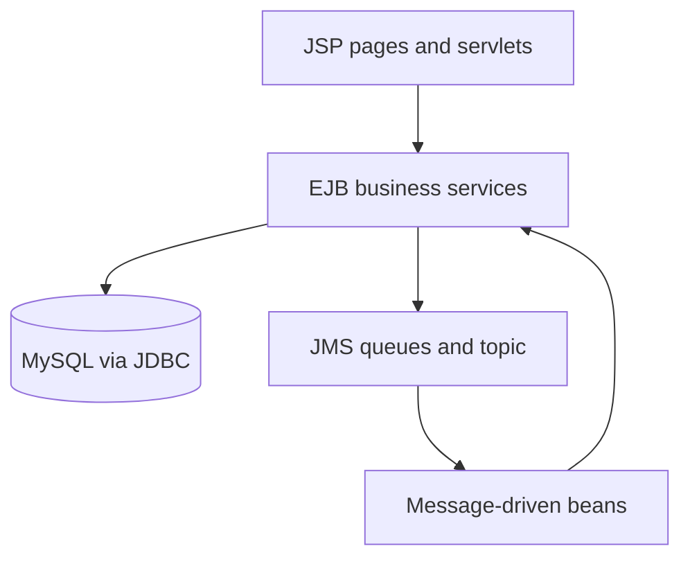

<div align="center">

# 🛒 TechMart Online

### Online Shopping with Jakarta EE

An academic e-commerce application exploring enterprise Java, asynchronous order processing and messaging.


[Features](#-features) · [Architecture](#-architecture) · [Getting Started](#-getting-started) · [Testing](#-testing)

</div>

---

## 📖 Overview

TechMart Online combines a customer storefront with administration pages for inventory, orders and application metrics. It demonstrates how EJB services, asynchronous processing and JMS messaging can support an online shopping workflow.

The application is organized into separate Maven modules for shared contracts, business logic, the web interface and EAR deployment.

## ✨ Features

| Area | Capabilities |
| --- | --- |
| Product catalogue | Browse products and view product details |
| Shopping cart | Session-based cart management |
| Checkout | Submit orders and view order confirmation |
| Customer orders | View personal order history |
| Administration | Dashboard, inventory and order management pages |
| Order processing | Asynchronous EJB processing and JMS order messages |
| Notifications | Queue-based notification processing and topic event consumers |
| Monitoring | Application counters and performance metrics |
| Authentication | Salted PBKDF2 password hashes and login session rotation |

## 🛠️ Technology Stack

<div align="center">

**Java · Jakarta EE 10 · EJB · JMS · JDBC**

**Servlets · JSP · JavaScript · MySQL · Payara 6 · Maven · JUnit 5**

</div>

The Maven compiler target is Java 11. Use **JDK 17** for the documented Payara 6 setup; no compiler-target change is required.

## 🏗️ Architecture

Customer and administration pages call servlet endpoints, which delegate business operations to EJB services. JDBC provides database persistence, while JMS producers and message-driven beans support background communication.



| Module / folder | Responsibility |
| --- | --- |
| `techmart-common/` | Shared DTOs, contracts, constants and password-hashing utility |
| `techmart-ejb/` | Business services, database access, asynchronous processing and messaging |
| `techmart-web/` | Customer storefront, administration pages and servlets |
| `techmart-ear/` | Enterprise application packaging |
| `database/` | MySQL schema and demo seed data |

## 🚀 Getting Started

### 1. Prerequisites

- JDK **17**
- Maven **3.9+**
- Payara Server **6**
- MySQL **8**
- IntelliJ IDEA or another Java IDE, if preferred

Open the root `pom.xml` as a Maven project and allow dependencies to load.

### 2. Prepare the database

Start MySQL and inspect/import:

```text
database/techmart_mysql.sql
```

The script creates the demo schema and sample data for **`techmart_db`**. It resets tables: use a disposable local database or back up existing data first. Keep other project databases separate.

### 3. Configure your database connection before running

Open:

```text
techmart-ejb/src/main/resources/techmart-db.properties
```

The supplied defaults are:

```properties
techmart.jdbc.url=jdbc:mysql://localhost:3306/techmart_db?useSSL=false&allowPublicKeyRetrieval=true&serverTimezone=Asia/Colombo
techmart.jdbc.user=root
techmart.jdbc.password=
```

**Before building and running, set the port, username and password to match your local MySQL installation.** The default port is `3306` and the password is empty. In a `.properties` file, leave nothing after `=` for an empty password; do not enter literal quotation marks.

If your MySQL account has a password, enter it locally and remove it before committing. Alternatively, configure `TECHMART_JDBC_URL`, `TECHMART_JDBC_USER` and `TECHMART_JDBC_PASSWORD` in the Payara server environment.

The application first looks for a configured datasource such as `jdbc/TechMartDS`. If one is found, its connection-pool settings take precedence over the direct JDBC properties. Otherwise, direct JDBC values are resolved from JVM properties, environment variables, then the properties file. Restart the server after changing environment settings and rebuild/redeploy after changing packaged properties.

### 4. Messaging configuration

Use Payara with its JMS service enabled. The application uses these physical destinations:

| Destination | Type |
| --- | --- |
| `TechMartOrderQueue` | Queue |
| `TechMartNotificationQueue` | Queue |
| `TechMartEventTopic` | Topic |

Ensure these destinations are available to the Payara messaging broker and its default JMS connection factory. The message-driven beans reference the physical names above; custom server configurations must match them.

### 5. Build and deploy

From the root folder:

```sh
mvn clean package
```

Deploy the generated EAR through IntelliJ IDEA or the Payara administration console:

```text
techmart-ear/target/techmart-modernization.ear
```

With Payara running and `asadmin` on your PATH, you can also use:

```sh
asadmin deploy techmart-ear/target/techmart-modernization.ear
```

Open [http://localhost:8080/techmart/](http://localhost:8080/techmart/).

### 6. Local demo accounts

After importing the supplied seed:

| Role | Username | Password |
| --- | --- | --- |
| Administrator | `admin` | `1234` |
| Customer | `vihanga` | `1234` |

These accounts are for local demonstrations only. Replace them before public deployment.

## 🧪 Testing

```sh
mvn clean test
```

The JUnit suite covers selected store behavior, performance-related checks and password hashing. After deployment, also check customer login, cart updates, order submission, order history, admin inventory and JMS message processing against your database.

## ⚙️ Authentication

User passwords are stored as salted PBKDF2 hashes.
Use the supplied SQL seed for the local demo accounts listed above.

## 👨‍💻 Developer

<h3>Vihanga Thathsara</h3>

<a href="https://github.com/VihangaThathsara">
  
</a>
&nbsp;&nbsp;
<a href="https://www.linkedin.com/in/vihanga-thathsara-00187543b/">
  
</a>

</div>
